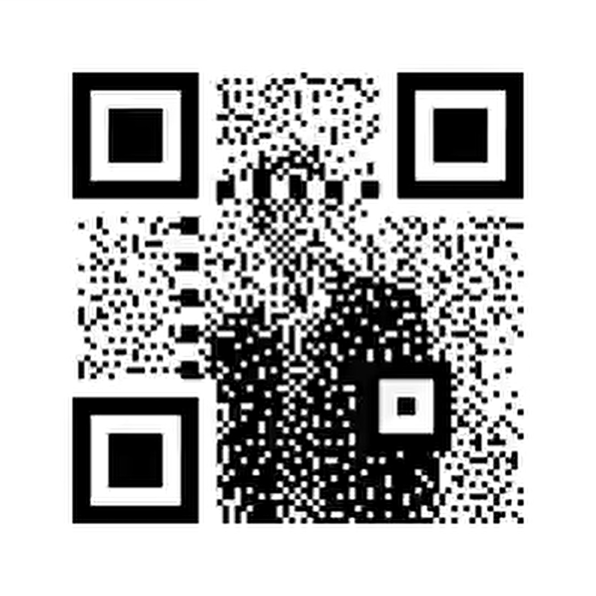

<div align="center">

# 你信不信QR掃我?😂
### Rick Astley QR Code Prank | 經典瑞克搖動態 QR Code

[](https://github.com/NiktoBlox/Rick-Astley-QR-Prank)
[](https://niktoblox.github.io/Rick-Astley-QR-Prank/)
[](https://www.youtube.com/watch?v=dQw4w9WgXcQ)
[](LICENSE)

<br/>



<br/>

### 📱 拿起手機掃瞄看看，有驚喜等著你！  
> *"Never Gonna Give You Up, Never Gonna Let You Down..."* 🕺✨

</div>

---

## 📖 專案介紹 (About)

這是一個結合了 **Rick Astley（瑞克·艾斯特利）** 經典魔性舞步與動態 QR Code 的惡搞專案！  
畫面中融合了迷因名曲《Never Gonna Give You Up》的動態畫面，外觀是一張會跳舞的動圖，但同時又具備 QR Code 的視覺特徵與滿滿的釣魚效果。

適合用於：
- 🎣 社交平台釣魚、群組整人、朋友互動
- 💻 嵌入個人 GitHub Profile README、專案文件裝飾
- 🎤 簡報結尾放一張「謝謝大家，掃碼填問卷」😈

---

## 🚀 如何使用 (How to Use)

### 1. 直接掃描
打開手機相機或條碼掃描 App，對準上方動態 GIF 掃描！

### 2. 嵌入在您的 Markdown 文件中
```markdown

```

### 3. HTML 嵌入語法
```html

```

---

## 🌐 線上展示 (Live Preview)

👉 **點此立即體驗線上展示**：[https://niktoblox.github.io/Rick-Astley-QR-Prank/](https://niktoblox.github.io/Rick-Astley-QR-Prank/)

支援全螢幕展示與手機最佳化，隨時隨地開啟釣魚！🎣

---

## ⚠️ 免責聲明 (Disclaimer)

本專案純屬網路迷因惡作劇（Rickroll 文化梗），不含任何惡意代碼或安全性危害，請安心使用並將快樂分享給身邊的朋友！😂

---

<div align="center">
Made with ❤️ for Rickroll & Meme Lovers worldwide.
</div>
